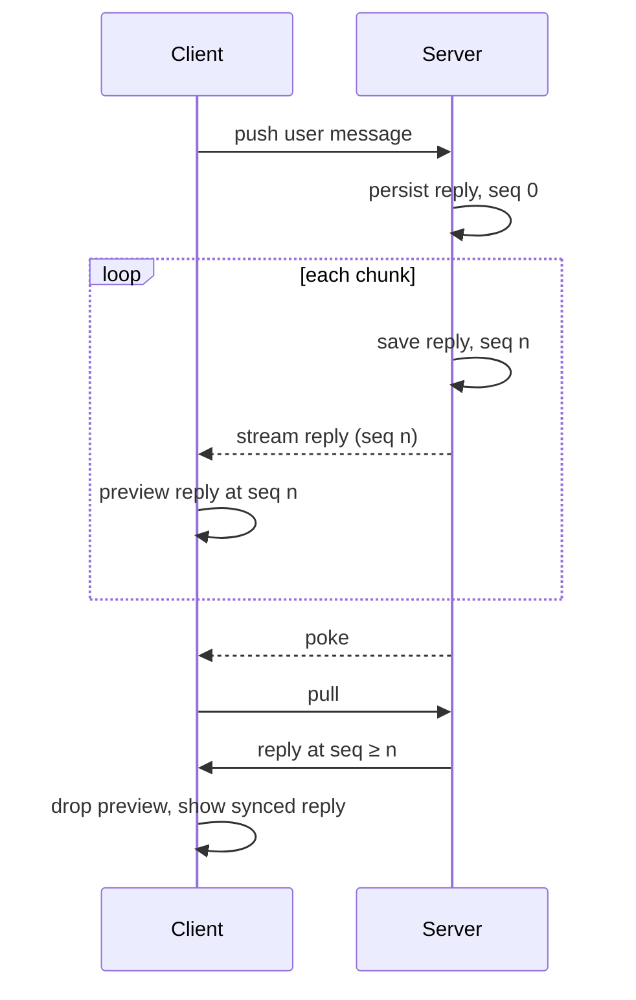

# Agent chat

This guide shows how to build a streaming agent chat on Tandem. The user's messages sync like any other record. The agent's reply streams from the server over a separate channel, and the client shows it with `client.preview` until sync catches up.

## Why the obvious approaches fail

A user sends a message by committing it to Tandem. The server receives the push and starts inference. Tokens then reach the client over a WebSocket or SSE stream, outside Tandem's push and pull.

Committing those tokens to Tandem makes the client a second writer of the reply. Each commit carries the text the client had when the token arrived, so it reaches the server at least a round trip after the server wrote newer text. A `set` replaces the whole record, so the server's reply moves backwards until the next token overwrites it.

Keeping the streamed text in separate local state avoids the second writer. But then the app has to decide when to stop showing it and go back to the Tandem record. Switch too early and the reply jumps backwards. Switch too late and later server edits stay hidden.

## The recommended path

1. One writer per record. The client writes user messages. Only the server writes assistant messages, and the push handler rejects client writes to them. Anything the client needs to say about a reply, such as a cancel request or a rating, goes in a record the client owns.
2. The server starts inference from an accepted push. The reply's ID comes from the user message's ID and is claimed in a transaction, so a retried push does not start a second reply.
3. The server saves each new chunk of the reply, then streams the whole saved message to everyone viewing the thread. Every save increments the message's `seq`. Never stream a `seq` the server will not save.
4. The client passes each streamed message to `client.preview`, never to `commit`. Tandem drops a preview once a pull delivers the message with a `seq` at least as high.



A pull can read the server before a chunk and arrive after it. The client keeps showing the preview, because the pulled `seq` is lower. Neither the client nor the server ever shows an older reply.

## Data model

```ts
type Message = {
	id: string
	threadId: string
	role: "user" | "assistant"
	text: string
	/** Incremented by the server on every persisted change to an assistant message. */
	seq: number
	status: "streaming" | "complete"
}
```

Store each message as its own record so that writes to one message cannot replace another. Subscribe to the open thread so pulls return its replies.

## Server

Wrap `TandemServer` in the transport the client calls. See [Custom remotes](custom-remote.md#wrapping-tandemserver).

```ts
async push(args) {
	for (const { ops } of args.mutations) {
		for (const op of ops) {
			if (op.type !== "set" || op.value.role !== "user") {
				return { error: "invalid-request", message: "Only the server writes assistant messages" }
			}
		}
	}
	const response = await server.push(args)
	if (!("error" in response)) startReplies(args.mutations)
	return response
}
```

Save each chunk, then publish the saved message:

```ts
reply = { ...reply, text: reply.text + chunk, seq: reply.seq + 1 }
const tx = server.transact()
tx.set("messages", reply)
await server.commit(tx)
stream.publish(reply.threadId, reply)
```

Each commit pokes connected clients. To reduce pull traffic, group tokens into chunks, for example every 50 to 100 ms.

If inference fails, persist a terminal status with a higher `seq`. That write replaces any preview the client is still showing.

## Client

Preview every streamed message:

```ts
stream.subscribe(threadId, (message) => {
	client.preview("messages", message, { version: "seq" })
})
```

That is all the client needs. `preview` ignores a message that is not newer than what the client already shows, so late, repeated, and out-of-order events are harmless. A client that joins mid-stream, or misses events, shows the synced message until the next streamed message or pull.

Queries and subscriptions return the preview in place of the synced record. Tandem drops it when:

- a pull delivers the record with `seq` at least as high
- a pull removes the record
- the client commits its own write to the record
- the app calls `client.clearPreview(collection, id)`

Previews live in memory. After a restart the client shows the synced record until the stream resumes.

## Replies with several messages

An agent turn often produces several messages: text, a tool call, a tool result, and more text. Store each as its own record with its own `seq`, for example with IDs `${userMessageId}:reply:0`, `:1`, and so on. Each has its own preview, and they retire independently. Order them with a field such as `index`.

## Who sees the stream

Publish to everyone viewing the thread, not only the sender. A friend with the same thread open sees the reply stream in, too. A viewer without the stream still sees each saved chunk through ordinary sync, a poke and a pull later.

## Why stream at all

Without the stream, every chunk costs each viewer a poke, then a pull request, and the pull response returns every record in the subscription, not just the changed one. The stream delivers the changed message in one hop, with no request. Updates show up sooner and arrive as smoothly as the server sends them. Saved chunks still poke clients, so grouping tokens into chunks keeps pull traffic down.

Each streamed event carries the whole message so far. For very long replies, the server can stream only the new text, and the client appends it to the visible message before previewing. That saves bandwidth but adds client code to detect gaps.

## Without a stream

If a poke and a pull per update is fast enough, skip the stream. The server saves chunks as above, and clients receive them through ordinary sync. Each pull returns every record in the client's scan window, so batch writes and scope subscriptions to the open thread.

## Limitations

- A preview of a record outside every subscription never retires, because pulls never return the record. Call `clearPreview` when its stream closes.
- If the server streams a `seq` and then crashes before persisting it, the preview stays until restart or `clearPreview`. Persisting before publishing prevents this.
- A pull that does not mention a record does not drop its preview, and neither does a reset snapshot that never contained it. The server may not have created the record when the pull read its view.
- Each preview is a local write. A transaction that reads a streaming message and commits later can fail with a read-write conflict, as it would after a pull.

The end-to-end test in [`packages/server/test/e2e/AgentChatStreaming.e2e.spec.ts`](../packages/server/test/e2e/AgentChatStreaming.e2e.spec.ts) implements this guide against a real `TandemServer`.
