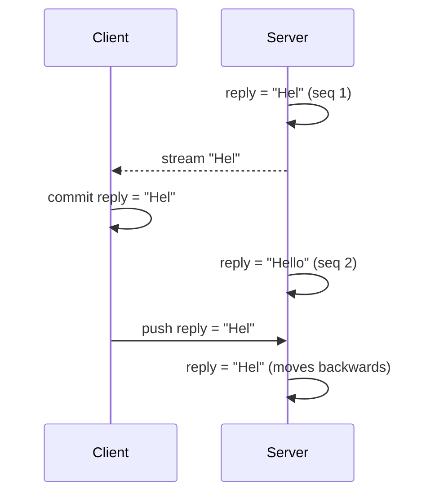

# Agent chat streaming

Implemented: `TandemClient.preview` and `clearPreview`, the [agent chat guide](../docs/agent-chat.md), and an end-to-end reference test. Patch-carrying pokes remain a follow-up.

## Problem overview

An agent chat sends a user message through Tandem. The server starts inference when it applies the push, and tokens stream to the client over a WebSocket or SSE connection outside push and pull. The client then has two bad options.

Committing streamed tokens makes the client a second writer of the assistant message. Each commit carries text from when the token arrived, and it reaches the server a round trip after the server wrote newer text. Mutations carry whole records, and the last applied write wins, so the server's copy moves backwards. Every client in the thread then pulls the regression.

Holding streamed text in app state outside Tandem avoids the second writer, but it leaves no rule for when to return to the Tandem record. The pulled record can be older than the stream (a pull read the server before the latest chunk), newer (the stream dropped events), or deleted.

## Solution overview

Treat streamed output like Tandem treats pending mutations: a layer over the server value that is discarded once the server value confirms it. Pending mutations retire by `lastMutationId`. Previews retire by a per-record version that the server increments on every persisted change.

- The server is the only writer of assistant messages, saves each chunk before publishing the whole saved message, and increments `seq` with each save.
- The client calls `client.preview(collection, message, { version: "seq" })` for each streamed message. Previews never enter the outbox.
- Each pull rebuilds records from bases and pending mutations, then applies previews that are still ahead of the pulled value.

Persisting before publishing makes every preview a prefix of some future server state. Retirement therefore never shows an older value, and every preview eventually retires.

## Goals

- Neither the server nor any client shows an older assistant message during or after streaming.
- Streamed output becomes visible as soon as it reaches the client, without a poke and pull round trip.
- Clients converge to the server record after streaming ends, with no app code deciding when to switch.
- The wire protocol, server, and storage formats stay unchanged.

## Non-goals

- A streaming transport. Apps bring their own WebSocket or SSE channel.
- Incremental pulls or patch-carrying pokes. See [Follow-ups](#follow-ups).
- Field-level merges. One writer per record is the data-model rule that makes previews safe.
- Persisting previews across restarts.

## Alternatives considered

| Approach                                                           | Outcome                                                                                                                                  |
| ------------------------------------------------------------------ | ---------------------------------------------------------------------------------------------------------------------------------------- |
| Commit streamed tokens from the client                             | Rejected. Two writers of one record. The server's copy regresses.                                                                        |
| App-held snapshot outside Tandem                                   | Rejected. No sound rule for when to return to the synced record.                                                                         |
| Server writes only, clients receive through poke and pull          | Correct, and documented as the simple path. It adds a poke and pull round trip per update, and every pull returns the whole scan window. |
| Global server revision in each pull, retiring previews by revision | Exact, including deletions. Requires a revision that external writers and storage adapters do not provide today.                         |
| Per-record version field                                           | Chosen. Works with any storage. Apps already keep fields like `seq` or `updatedAt`.                                                      |

## Implementation

### Client preview layer

`Database` keeps previews in an in-memory map keyed by record key. Previewing a record without a base saves its current value as the base with `lastWrittenBy` 0, so pulls can rebuild beneath the preview. Out-of-order values are ignored when the visible preview or the base value already has an equal or higher version.

`Database.applyPull` gains one step after replaying the outbox. For each preview, it retires the preview when the base value is set and its version is at least the preview's, or when the pull removed the record. It writes every remaining preview over the rebuilt record. Base pruning skips previewed records.

A pull removes a record by an explicit remove, or by a reset snapshot that lacks a record the client had confirmed before the pull. Pulls are serialized, so a newer snapshot missing a previously confirmed record means the server dropped it. An absent record the client never confirmed keeps its preview, in reset and non-reset pulls alike. The stream can outrun the pull that creates the record, and a reset snapshot can be read before it.

`Database` remembers records that pulls removed and ignores previews of them until a pull sets them again. Otherwise a stream event delayed past the removal would preview a record that no later pull mentions, so the preview would never retire.

`commitMutation` retires previews of records the mutation writes, because a local write supersedes a preview. `clearPreview` restores the base value, replays pending operations for that record, and drops the base unless its last writer is still in the outbox. `clear` drops all previews.

Records and bases are persisted as before. Previews are not, but saved records can contain their values. Only a preview keeps a base whose last writer is no longer pending, so hydration restores those records to their base values and drops the bases. A preview over a record with a still-pending local write survives restart until the next pull. Under the one-writer rule, previewed records have no local writes.

### Verification

[`packages/core/test/sync/previews.spec.ts`](../packages/core/test/sync/previews.spec.ts) covers retirement on catch-up, a preview that arrives before the record is created, ignored late and out-of-order values, a Gatekeeper-held pull that read the server before the preview, a reset snapshot read before the record existed, removal, a late event after removal, `clearPreview`, a local write superseding a preview, and restart. Each rule's test fails if that rule is removed from `Database`.

[`packages/server/test/e2e/AgentChatStreaming.e2e.spec.ts`](../packages/server/test/e2e/AgentChatStreaming.e2e.spec.ts) runs the guide against `TandemServer` with JSON-file storage, real pokes, and delayed pull responses. It asserts that the client sees every prefix of the reply in order, that the server's copy only grows, and that the client converges. The test fails if previews are skipped or if a pull overwrites them.

## Follow-ups

- Patch-carrying pokes: push incremental patches with chained cookies over the poke channel, as Zero does. Saved chunks would then reach clients in one hop without a separate stream, and previews would be needed only for unpersisted output.
- An agent chat example app on top of the SSE poke transport.
