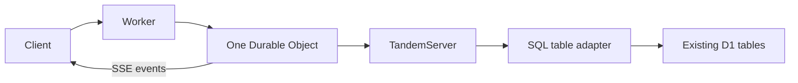

# Existing SQL tables and Cloudflare hosting

## Problem overview

`TandemServer` accepts storage operations over tuple keys. The only supplied durable server adapter stores those keys in a JSON file. Applications need to sync records from their own SQL tables without adopting another application schema.

```callstack
 TandemServer [[packages/server/src/TandemServer.ts#TandemServer]]
 └── TandemServerStorageApi [[packages/server/src/storage/TandemServerStorage.ts#TandemServerStorageApi]]
    ├── scan ordered tuple keys
    └── commit a write batch
```

## Solution overview

Add SQL storage that maps each collection to a table and each ID part to a primary-key column. Applications encode records into column values and decode rows into records. Kysely compiles parameterized SQLite, PostgreSQL, and MySQL statements. The host supplies row execution and atomic batch execution, so no database driver or framework becomes a runtime dependency.



The adapter pushes shared ID-prefix constraints into SQL and applies exact tuple ordering, remaining bounds, and limits in memory for each scan. Advanced SQL query pushdown remains separate work. Records stay in SQL; client acknowledgements live only in this adapter instance. Lost acknowledgements can cause duplicate replay or mutation gaps after restart, so this first adapter is experimental and does not claim restart-safe writes.

## Goals

- Read and update existing application tables, including compound primary keys.
- Preserve unmapped columns and use an atomic SQL batch for record writes.
- Support SQL dialect selection without requiring a particular driver or ORM.
- Document one D1 database, one Durable Object, and the existing SSE transport.
- Exercise public server/client workflows against real SQL engines and D1.

## Non-goals

- Durable sync metadata, acknowledgement tables, or changes to the sync protocol.
- Database migrations, arbitrary external-write notifications, or multi-tenant routing.
- WebSockets, hibernation, R2 adapters, or advanced SQL query compilation.

## Implementation

### Phase 1: SQL storage

Provide a separate SQL package entry so consumers can import the adapter without database drivers. Test existing-row reads, changes visible through SQL, compound IDs, rollback, and two-client sync. Use deterministic simulation with the adapter to exercise network faults and client crashes.

- [x] Implement `TandemServerSqlStorage` and its table/execution contracts.
- [x] Run focused adapter tests, type checks, and deterministic seed sweeps.

Verification: 18 adapter cases pass across D1, PGlite, and MySQL 8.4. Server checks pass (92 tests, with six optional MySQL cases skipped in the default command). DST passes 145 tests, including five SQL-backed fault/crash seeds and their exact replays. Lint, type checks, and formatting pass.

### Phase 2: Cloudflare guide

Explain table mapping and dialect/driver ownership, then show Worker routing, D1 reads and atomic batches, SSE, client setup, local commands, and deployment. State the current restart and query limitations next to the setup.

- [ ] Add SQL and Cloudflare guides to the docs navigation.
- [ ] Verify the guide's Worker code against local Cloudflare runtime.

## References

- [Kysely query compilation](https://www.kysely.dev/docs/recipes/splitting-query-building-and-execution)
- [D1 atomic batches](https://developers.cloudflare.com/d1/worker-api/d1-database/#batch)
- [Existing SSE helpers](../packages/server/src/TandemEventStream.ts)
