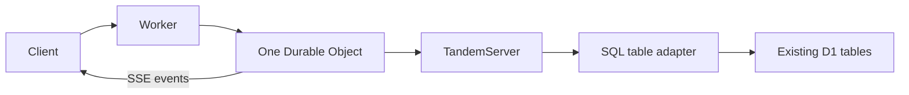

# Existing SQL tables and Cloudflare hosting

## Problem overview

`TandemServer` accepts storage operations over tuple keys. The only supplied durable server adapter stores those keys in a JSON file. Applications need to sync records from their own SQL tables without adopting another application schema.

```callstack
 TandemServer [[packages/server/src/TandemServer.ts#TandemServer]]
 └── TandemServerStorageApi [[packages/server/src/storage/TandemServerStorage.ts#TandemServerStorageApi]]
    ├── scan ordered tuple keys
    └── commit a write batch
```

## Solution overview

Add SQL storage that maps each collection to a table and each ID part to a primary-key column. Applications encode records into column values and decode rows into records. Kysely compiles parameterized SQLite, PostgreSQL, and MySQL statements. The host supplies row execution and atomic batch execution, so no database driver or framework becomes a runtime dependency.



The adapter pushes shared ID-prefix constraints into SQL and applies exact tuple ordering, remaining bounds, and limits in memory for each scan. Advanced SQL query pushdown remains separate work. Records stay in SQL; client acknowledgements live only in this adapter instance. Lost acknowledgements can cause duplicate replay or mutation gaps after restart, so this first adapter is experimental and does not claim restart-safe writes.

## Goals

- Read and update existing application tables, including compound primary keys.
- Preserve unmapped columns and use an atomic SQL batch for record writes.
- Support SQL dialect selection without requiring a particular driver or ORM.
- Document one D1 database, one Durable Object, and the existing SSE transport.
- Exercise public server/client workflows against real SQL engines and D1.

## Non-goals

- Durable sync metadata, acknowledgement tables, or changes to the sync protocol.
- Database migrations, arbitrary external-write notifications, or multi-tenant routing.
- WebSockets, hibernation, R2 adapters, or advanced SQL query compilation.

## Implementation

### Phase 1: SQL storage

Provide a separate SQL package entry so consumers can import the adapter without database drivers. Test existing-row reads, changes visible through SQL, compound IDs, rollback, and two-client sync. Use deterministic simulation with the adapter to exercise network faults and client crashes.

- [x] Implement `TandemServerSqlStorage` and its table/execution contracts.
- [x] Run focused adapter tests, type checks, and deterministic seed sweeps.

Verification: 18 adapter cases pass across D1, PGlite, and MySQL 8.4. Server checks pass (92 tests, with six optional MySQL cases skipped in the default command). DST passes 145 tests, including five SQL-backed fault/crash seeds and their exact replays. Lint, type checks, and formatting pass.

```callstack
 TandemServerStorageApi [[packages/server/src/storage/TandemServerStorage.ts#TandemServerStorageApi]]
 └── TandemServerSqlStorage [[sql-adapter:new:91-108]]
    ├── scan # read SQL rows and apply tuple bounds [[sql-adapter:new:110-152]]
    └── commit # publish SQL writes before in-memory acknowledgements [[sql-adapter:new:154-173]]
```

```source-diff:sql-adapter:packages/server/src/storage/TandemServerSqlStorage.ts
diff --git a/packages/server/src/storage/TandemServerSqlStorage.ts b/packages/server/src/storage/TandemServerSqlStorage.ts
new file mode 100644
index 0000000..6e78446
--- /dev/null
+++ b/packages/server/src/storage/TandemServerSqlStorage.ts
@@ -0,0 +1,242 @@
+import type {
+	AnyCollectionSchema,
+	AnySchema,
+	CollectionName,
+} from "@tanishqkancharla/tandem-core"
+import { collectionIdToTuple } from "@tanishqkancharla/tandem-core/internal"
+import * as errore from "errore"
+import {
+	DummyDriver,
+	Kysely,
+	MysqlAdapter,
+	MysqlIntrospector,
+	MysqlQueryCompiler,
+	PostgresAdapter,
+	PostgresIntrospector,
+	PostgresQueryCompiler,
+	SqliteAdapter,
+	SqliteIntrospector,
+	SqliteQueryCompiler,
+	sql,
+} from "kysely"
+import { InMemoryTupleStorage } from "tuple-database"
+import type { ScanStorageArgs, WriteOps } from "tuple-database"
+import { getPrefixContainingBounds } from "tuple-database/helpers/sortedTupleArray.js"
+import type {
+	TandemServerStorageApi,
+	TandemTuple,
+} from "./TandemServerStorage.js"
+
+export type TandemSqlDialect = "sqlite" | "postgres" | "mysql"
+export type TandemSqlRow = Record<string, unknown>
+export type TandemSqlStatement = {
+	readonly sql: string
+	readonly parameters: readonly unknown[]
+}
+
+type IdColumns<Id> = Id extends readonly [unknown, ...unknown[]]
+	? { readonly [Index in keyof Id]: string }
+	: readonly [string]
+
+export type TandemSqlTable<Record extends AnyCollectionSchema> = {
+	table: string
+	/** Primary-key columns in the same order as the record's ID parts. */
+	idColumns: IdColumns<Record["id"]>
+	/** Encode mapped columns. ID columns are supplied from the record key. */
+	encode: (record: Record) => TandemSqlRow
+	/** Decode a SQL row, including its scalar or compound ID. */
+	decode: (row: TandemSqlRow) => Record
+}
+
+export type TandemServerSqlStorageArgs<Schema extends AnySchema> = {
+	dialect: TandemSqlDialect
+	tables: { [C in CollectionName<Schema>]: TandemSqlTable<Schema[C]> }
+	query: (statement: TandemSqlStatement) => Promise<TandemSqlRow[]>
+	/** Execute all statements atomically, or reject without committing any. */
+	commit: (statements: readonly TandemSqlStatement[]) => Promise<void>
+}
+
+class TandemSqlStorageError extends errore.createTaggedError({
+	name: "TandemSqlStorageError",
+	message: "SQL storage could not $operation",
+}) {}
+
+const compilers = {
+	sqlite: {
+		createAdapter: () => new SqliteAdapter(),
+		createQueryCompiler: () => new SqliteQueryCompiler(),
+		createIntrospector: (db: Kysely<unknown>) => new SqliteIntrospector(db),
+	},
+	postgres: {
+		createAdapter: () => new PostgresAdapter(),
+		createQueryCompiler: () => new PostgresQueryCompiler(),
+		createIntrospector: (db: Kysely<unknown>) => new PostgresIntrospector(db),
+	},
+	mysql: {
+		createAdapter: () => new MysqlAdapter(),
+		createQueryCompiler: () => new MysqlQueryCompiler(),
+		createIntrospector: (db: Kysely<unknown>) => new MysqlIntrospector(db),
+	},
+}
+
+/**
+ * Maps application records onto existing SQL tables. Client acknowledgements
+ * are instance-local: this adapter does not yet support restart-safe retries.
+ * The host owns the database connection and must serialize writers through one
+ * TandemServer. close() never closes the host's database.
+ */
+export class TandemServerSqlStorage<
+	Schema extends AnySchema,
+> implements TandemServerStorageApi<Schema> {
+	private readonly clients = new InMemoryTupleStorage()
+	private readonly compiler: Kysely<unknown>
+	private readonly tables: Array<
+		[CollectionName<Schema>, TandemSqlTable<Schema[CollectionName<Schema>]>]
+	>
+	private readonly query: TandemServerSqlStorageArgs<Schema>["query"]
+	private readonly commitSql: TandemServerSqlStorageArgs<Schema>["commit"]
+
+	constructor(args: TandemServerSqlStorageArgs<Schema>) {
+		this.compiler = new Kysely({
+			dialect: {
+				...compilers[args.dialect],
+				createDriver: () => new DummyDriver(),
+			},
+		})
+		// Erase only the collection-specific parameter type while enumerating the
+		// mapping; the public constructor checks each collection independently.
+		this.tables = Object.entries(args.tables) as typeof this.tables
+		this.query = args.query
+		this.commitSql = args.commit
+	}
+
+	async scan(args: ScanStorageArgs = {}): Promise<TandemTuple<Schema>[]> {
+		const prefix = getPrefixContainingBounds(args)
+		const memory = new InMemoryTupleStorage(this.clients.scan())
+		for (const [collection, table] of this.tables) {
+			if (prefix.length > 0 && prefix[0] !== "record") continue
+			if (prefix.length > 1 && prefix[1] !== collection) continue
+			const parts = prefix.slice(2)
+			if (parts.length > table.idColumns.length) continue
+			const conditions = parts.map(
+				(part, index) => sql`${sql.id(table.idColumns[index])} = ${part}`,
+			)
+			const where = conditions.length
+				? sql`where ${sql.join(conditions, sql` and `)}`
+				: sql``
+			const statement =
+				sql`select * from ${sql.id(table.table)} ${where}`.compile(
+					this.compiler,
+				)
+			const rows = await this.query(statement).catch(
+				(cause) => new TandemSqlStorageError({ operation: "read rows", cause }),
+			)
+			if (rows instanceof Error) throw rows
+			const decoded = errore.try({
+				try: () =>
+					rows.map((row) => {
+						const value = table.decode(row)
+						const id = collectionIdToTuple(value.id)
+						return { key: ["record", collection, ...id], value }
+					}),
+				catch: (cause) =>
+					new TandemSqlStorageError({ operation: "decode rows", cause }),
+			})
+			if (decoded instanceof Error) throw decoded
+			memory.commit({ set: decoded })
+		}
+		// SQL collations need not match tuple ordering. Apply the exact bounds,
+		// ordering and global limit after decoding, without retaining record data.
+		return memory.scan(args) as TandemTuple<Schema>[]
+	}
+
+	async commit(writes: WriteOps<TandemTuple<Schema>>): Promise<void> {
+		const statements = this.statements(writes)
+		if (statements instanceof Error) throw statements
+		if (statements.length) {
+			const committed = await this.commitSql(statements).catch(
+				(cause) =>
+					new TandemSqlStorageError({ operation: "commit rows", cause }),
+			)
+			if (committed instanceof Error) throw committed
+		}
+		// Advance receipts only after every SQL write succeeds.
+		this.clients.commit({
+			set: writes.set?.filter(({ key }) => key[0] === "client"),
+			remove: writes.remove?.filter((key) => key[0] === "client"),
+		})
+	}
+
+	close(): Promise<void> {
+		return this.compiler.destroy()
+	}
+
+	private statements(writes: WriteOps<TandemTuple<Schema>>) {
+		const statements: TandemSqlStatement[] = []
+		for (const key of writes.remove ?? []) {
+			if (key[0] !== "record") continue
+			const table = this.table(key[1])
+			if (table instanceof Error) return table
+			const conditions = table.idColumns.map(
+				(column, index) => sql`${sql.id(column)} = ${key[index + 2]}`,
+			)
+			statements.push(
+				sql`delete from ${sql.id(table.table)} where ${sql.join(conditions, sql` and `)}`.compile(
+					this.compiler,
+				),
+			)
+		}
+		for (const { key, value } of writes.set ?? []) {
+			if (key[0] !== "record") continue
+			const table = this.table(key[1])
+			if (table instanceof Error) return table
+			const encoded = errore.try({
+				try: () => table.encode(value as Schema[CollectionName<Schema>]),
+				catch: (cause) =>
+					new TandemSqlStorageError({ operation: "encode a record", cause }),
+			})
+			if (encoded instanceof Error) return encoded
+			const columns = {
+				...encoded,
+				...Object.fromEntries(
+					table.idColumns.map((column, index) => [column, key[index + 2]]),
+				),
+			}
+			const entries = Object.entries(columns)
+			const fields = entries.filter(
+				([column]) => !table.idColumns.includes(column),
+			)
+			const insert = sql`insert into ${sql.id(table.table)} (${sql.join(entries.map(([column]) => sql.id(column)))})`
+			const values = sql.join(entries.map(([, value]) => sql.val(value)))
+			// Update by primary key first: an INSERT ... ON CONFLICT can reject
+			// existing rows whose required, app-owned columns are not mapped.
+			const where = sql.join(
+				table.idColumns.map(
+					(column) => sql`${sql.id(column)} = ${columns[column]}`,
+				),
+				sql` and `,
+			)
+			if (fields.length)
+				statements.push(
+					sql`update ${sql.id(table.table)} set ${sql.join(fields.map(([column, value]) => sql`${sql.id(column)} = ${value}`))} where ${where}`.compile(
+						this.compiler,
+					),
+				)
+			statements.push(
+				sql`${insert} select ${values} where not exists (select 1 from ${sql.id(table.table)} where ${where})`.compile(
+					this.compiler,
+				),
+			)
+		}
+		return statements
+	}
+
+	private table(collection: CollectionName<Schema>) {
+		const entry = this.tables.find(([name]) => name === collection)
+		if (!entry)
+			return new TandemSqlStorageError({
+				operation: `find the table for ${collection}`,
+			})
+		return entry[1]
+	}
+}
```

### Phase 2: Cloudflare guide

Explain table mapping and dialect/driver ownership, then show Worker routing, D1 reads and atomic batches, SSE, client setup, local commands, and deployment. State the current restart and query limitations next to the setup.

- [x] Add SQL and Cloudflare guides to the docs navigation.
- [x] Verify the guide's Worker code against local Cloudflare runtime.

Verification: the Cloudflare example passes lint, type checking, Wrangler deployment dry-run, and its two-client SSE/D1 end-to-end test. The docs production build and package publication smoke test pass. Both new guide pages render without browser errors or horizontal page overflow at 1440 × 1000 and an emulated 390 × 844 viewport.

## References

- [Kysely query compilation](https://www.kysely.dev/docs/recipes/splitting-query-building-and-execution)
- [D1 atomic batches](https://developers.cloudflare.com/d1/worker-api/d1-database/#batch)
- [Existing SSE helpers](../packages/server/src/TandemEventStream.ts)
