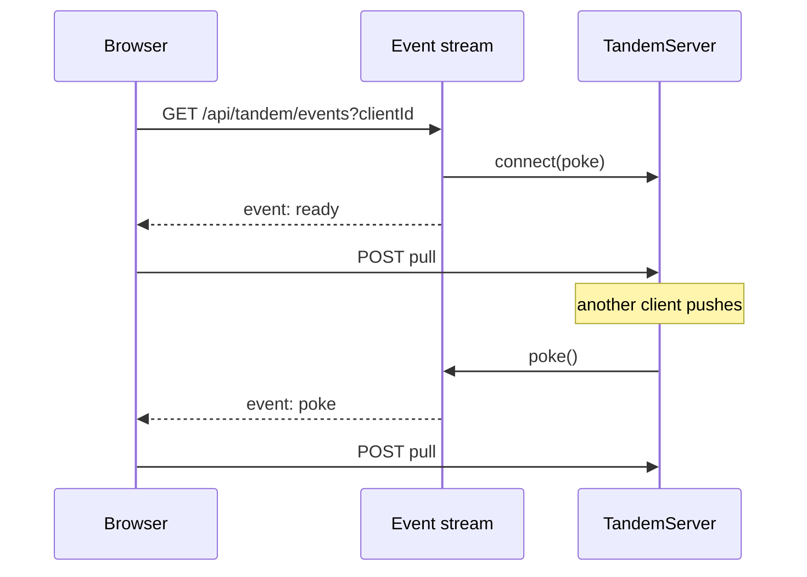

# SSE sync

## Problem overview

Browser clients learn about new server data only by polling. The todo example pulls every second, which is wasteful when idle and still up to a second late. `TandemServer` already pokes connected clients after every commit and storage notification, but those pokes stay inside the server process.

## Solution overview

Deliver pokes to browsers over server-sent events and keep HTTP POST push and pull as the only data path. A poke carries no data; it tells the client to pull. This is the Replicache model: SSE hint, then a normal pull, with a background pull every 60 seconds to check for missed updates. Electric uses SSE to stream data itself, which would duplicate Tandem's pull protocol.

## Goals

- A reusable server helper that turns any remote's `connect` into an SSE `Response`, independent of Hono.
- A reusable browser helper that turns the stream into `poke` calls, pulls after every (re)connection, and pulls every 60 seconds as a fallback.
- Heartbeats, no-buffer and no-cache headers, and disposal that unregisters, clears timers, and closes streams exactly once.
- No leaked or duplicate registrations across reconnects, StrictMode, and `clear()`.
- The todo example syncs live between browsers.

## Non-goals

- WebSockets or an external pub/sub service.
- Multi-process fanout. Pokes reach only streams connected to the process that committed or received a storage notification; other processes rely on the fallback pull until storage notifications or shared fanout exist ([docs/roadmap.md](../docs/roadmap.md)).
- Durable or replayable events. A missed poke delays a pull; it never loses data.

## Implementation

### ✅ Phase 1: One live registration per connection

**Today**

`TandemServer` keeps one poke slot per client. If a stale stream's request lands after its replacement registered, the stale stream takes the slot, and closing it clears the slot, so the live stream stops receiving pokes. `SyncEngine.disconnect` only unregisters a connection that already resolved, so React StrictMode's connect, disconnect, connect leaves two transports registered.

**Proposed**

The server stores a set of poke callbacks per client. Each `connect` registers its own wrapper and its disconnect removes only that wrapper:

```callstack
 TandemServer.connect [[ts:new:189-198]]
+├── add a per-connection wrapper to client.pokes # each disconnect deletes only its own entry
 TandemServer.emitPokes [[ts:new:429-440]]
+└── call every poke in client.pokes
```

`SyncEngine` advances a connection generation on every disconnect. A connect that resolves after a disconnect unregisters itself, and a newer connection replaces any older one:

```callstack
 SyncEngine.connect
 └── SyncEngine.connectToRemote [[se:new:199-216]]
     ├── remote.connect
+    ├── unregister and return if disconnect ran meanwhile
+    └── replace and unregister the previous registration
 SyncEngine.disconnect [[se:new:220-226]]
+└── advance connectionGeneration before unregistering
```

### ✅ Phase 2: SSE helpers

**Today**

Remotes call `poke` from any signal they choose. The quickstart and todo example poll every second. Tandem ships no SSE transport.

**Proposed**

`createTandemEventStreamResponse` in `@tanishqkancharla/tandem-server` turns a remote's `connect` into a web-standard `Response`. It registers the poke callback first, then writes `ready`, so a pull started from `ready` sees every write committed after registration:

```callstack
 createTandemEventStreamResponse [[es:new:31-109]]
 ├── remote.connect({ clientId, poke }) [[es:new:68-78]] # 503 if registration fails, cause logged
 ├── setInterval(heartbeat) [[es:new:80-83]] # ": keep-alive" every 15 s, skipped while the reader is behind
 ├── enqueue("event: ready") [[es:new:96-100]]
 └── close on signal abort or body cancel [[es:new:84-94]] # clear timer, unregister once
```

`poke` only enqueues a frame, so commits never wait on a browser. When the reader is behind, pokes collapse into one pending frame that `pull` writes next, and heartbeats are skipped because queued frames already keep the connection busy. A stalled response holds at most the ready event and one poke:

```ts
const poke = () => {
	if (hasCapacity()) enqueue(pokeFrame)
	else pokePending = true
	return Promise.resolve()
}
setInterval(() => {
	if (hasCapacity()) enqueue(heartbeatFrame)
}, heartbeatInterval)
```

`connectTandemEventSource` in `@tanishqkancharla/tandem-core` is the browser side. It pulls on `ready`, on `poke`, and every 60 seconds. Native EventSource retries dropped streams; when the browser gives up (a non-200 response), the helper reopens after 5 seconds:

```callstack
 connectTandemEventSource [[src:new:22-63]]
 ├── open: new EventSource(url) [[src:new:38-44]]
 │   ├── on ready → poke() # pull after every (re)connection
 │   ├── on poke → poke()
 │   └── on error with readyState CLOSED → reopen after reconnectDelay
 ├── setInterval(poke, pullInterval) # fallback, null disables
 └── return unsubscribe [[src:new:57-62]] # close source, clear both timers
```



### ✅ Phase 3: Todo example over SSE

**Today**

`TodoHttpRemote.connect` polls with `setInterval(poke, 1000)`. The Hono server has only `POST /api/tandem`.

**Proposed**

The Hono app serves `GET /api/tandem/events` with the server helper. It combines the request signal with an app-wide shutdown signal, because open streams otherwise keep `nodeServer.close` waiting forever:

```callstack
 createTodoApp [[app:new:106-129]]
+├── app.get("/api/tandem/events") # 400 without clientId
+│   └── createTandemEventStreamResponse(signal: request ∪ shutdown)
 start → shutdown [[idx:new:81-87]]
 ├── nodeServer.close
+└── service.endEventStreams
```

The browser remote returns `connectTandemEventSource` from `connect`. It keeps the local poke after a successful push so the pushing client acknowledges its own write without waiting for the stream:

```callstack
 TodoHttpRemote.connect [[rem:new:58-72]]
-├── setInterval(poke, 1000)
+└── connectTandemEventSource({ url: /api/tandem/events?clientId, poke })
 TodoHttpRemote.push [[rem:new:78-85]]
 └── poke() # unchanged prompt acknowledgement
```

Playwright covers the real browser path: two browsers sync without polling, a browser whose stream was refused catches a missed write after the stream reconnects, and a browser with no stream catches up when its clock passes the 60 second fallback.

```source-diff:ts:packages/server/src/TandemServer.ts
diff --git a/packages/server/src/TandemServer.ts b/packages/server/src/TandemServer.ts
index 5dfc355..785b31e 100644
--- a/packages/server/src/TandemServer.ts
+++ b/packages/server/src/TandemServer.ts
@@ -75,7 +75,8 @@ type SyncedRecordKey<
 }[Collection]
 
 type SyncClientState<Schema extends AnySchema> = {
-	poke?: ClientApi["poke"]
+	// Reconnects and tabs sharing a client identity can overlap connections.
+	pokes: Set<ClientApi["poke"]>
 	cookie?: Cookie
 	syncedRecordKeys?: SyncedRecordKey<Schema>[]
 }
@@ -186,16 +187,12 @@ export class TandemServer<
 	}
 
 	connect = ({ clientId, poke }: ClientApi) => {
-		const client = this.getSyncClient(clientId)
-		client.poke = poke
-		let disconnected = false
+		// Wrap so each connection unregisters only itself, even if callers reuse a callback.
+		const connection = () => poke()
+		this.getSyncClient(clientId).pokes.add(connection)
 
 		return Promise.resolve(() => {
-			if (disconnected) return Promise.resolve()
-			disconnected = true
-
-			const current = this.syncClients.get(clientId)
-			if (current?.poke === poke) current.poke = undefined
+			this.syncClients.get(clientId)?.pokes.delete(connection)
 			return Promise.resolve()
 		})
 	}
@@ -307,7 +304,7 @@ export class TandemServer<
 		const current = this.syncClients.get(clientId)
 		if (current) return current
 
-		const created: SyncClientState<Schema> = {}
+		const created: SyncClientState<Schema> = { pokes: new Set() }
 		this.syncClients.set(clientId, created)
 		return created
 	}
@@ -431,13 +428,13 @@ export class TandemServer<
 
 	private emitPokes() {
 		for (const client of this.syncClients.values()) {
-			if (!client.poke) continue
-
-			const result = errore.try(client.poke)
-			if (result instanceof Error) {
-				console.error(
-					new TandemServerError({ operation: "poke", cause: result }),
-				)
+			for (const poke of client.pokes) {
+				const result = errore.try(poke)
+				if (result instanceof Error) {
+					console.error(
+						new TandemServerError({ operation: "poke", cause: result }),
+					)
+				}
 			}
 		}
 	}
```

```source-diff:se:packages/core/src/sync/SyncEngine.ts
diff --git a/packages/core/src/sync/SyncEngine.ts b/packages/core/src/sync/SyncEngine.ts
index 4e6e1ef..a65a2a6 100644
--- a/packages/core/src/sync/SyncEngine.ts
+++ b/packages/core/src/sync/SyncEngine.ts
@@ -123,6 +123,8 @@ export class SyncEngine<Schema extends AnySchema> {
 	private readonly rng: RngApi
 
 	private disconnectFromRemote?: AsyncUnsubscribe
+	// Advances on disconnect so a connect still in flight unregisters when it resolves.
+	private connectionGeneration = 0
 	private scanWindow: ScanWindow<Schema> = []
 
 	get clientId(): ClientId {
@@ -173,6 +175,7 @@ export class SyncEngine<Schema extends AnySchema> {
 
 	private async connectToRemote() {
 		this.logger.info({ message: "connecting to remote" })
+		const generation = this.connectionGeneration
 		if (!this.db.isReady) await this.db.ready
 		// Clear can rotate identity during either await; connect the new durable session instead.
 		for (;;) {
@@ -196,11 +199,18 @@ export class SyncEngine<Schema extends AnySchema> {
 					cause: unsubscribe,
 				})
 			}
+			if (generation !== this.connectionGeneration) {
+				await unsubscribe()
+				return
+			}
 			if (clientId !== this.clientId) {
 				await unsubscribe()
 				continue
 			}
+			// Overlapping connect calls keep only the newest registration.
+			const previous = this.disconnectFromRemote
 			this.disconnectFromRemote = unsubscribe
+			await previous?.()
 
 			this.logger.info({ message: "connected to remote" })
 			return
@@ -209,8 +219,10 @@ export class SyncEngine<Schema extends AnySchema> {
 
 	async disconnect() {
 		this.logger.info({ message: "disconnecting from remote" })
-		await this.disconnectFromRemote?.()
+		this.connectionGeneration += 1
+		const unsubscribe = this.disconnectFromRemote
 		this.disconnectFromRemote = undefined
+		await unsubscribe?.()
 	}
 
 	subscribe(query: EncodedQuery<Schema>): Unsubscribe {
```

```source-diff:es:packages/server/src/TandemEventStream.ts
diff --git a/packages/server/src/TandemEventStream.ts b/packages/server/src/TandemEventStream.ts
new file mode 100644
index 0000000..ed9f4bf
--- /dev/null
+++ b/packages/server/src/TandemEventStream.ts
@@ -0,0 +1,109 @@
+import type {
+	AnySchema,
+	ClientId,
+	RemoteApi,
+} from "@tanishqkancharla/tandem-core"
+import * as errore from "errore"
+import { TandemServerError } from "./TandemServerError.js"
+
+export type TandemEventStreamArgs = {
+	/** Registers the stream for pokes, such as a `TandemServer` or a wrapper around one. */
+	remote: Pick<RemoteApi<AnySchema>, "connect">
+	clientId: ClientId
+	/** Aborts when the request ends. Cancelling the response body also closes the stream. */
+	signal?: AbortSignal
+	/** Milliseconds between keep-alive comments. Defaults to 15 seconds. */
+	heartbeatInterval?: number
+}
+
+const encoder = new TextEncoder()
+const readyFrame = encoder.encode("event: ready\ndata:\n\n")
+const pokeFrame = encoder.encode("event: poke\ndata:\n\n")
+const heartbeatFrame = encoder.encode(": keep-alive\n\n")
+
+/**
+ * Streams data-free pull hints to one client as server-sent events.
+ *
+ * Sends `ready` after the poke callback is registered and `poke` whenever
+ * committed data may have changed. Clients pull over the normal sync
+ * transport in response.
+ */
+export async function createTandemEventStreamResponse({
+	remote,
+	clientId,
+	signal,
+	heartbeatInterval = 15_000,
+}: TandemEventStreamArgs): Promise<Response> {
+	let controller!: ReadableStreamDefaultController<Uint8Array>
+	let closed = false
+	// A reader that falls behind gets one pending poke, not one frame per commit.
+	let pokePending = false
+
+	const enqueue = (frame: Uint8Array) => {
+		if (!closed) controller.enqueue(frame)
+	}
+	const hasCapacity = () =>
+		controller.desiredSize !== null && controller.desiredSize > 0
+	const poke = () => {
+		if (hasCapacity()) {
+			enqueue(pokeFrame)
+		} else {
+			pokePending = true
+		}
+		return Promise.resolve()
+	}
+
+	const body = new ReadableStream<Uint8Array>({
+		start: (streamController) => {
+			controller = streamController
+		},
+		pull: () => {
+			if (!pokePending) return
+			pokePending = false
+			enqueue(pokeFrame)
+		},
+		cancel: () => close(),
+	})
+
+	const connected = await remote
+		.connect({ clientId, poke })
+		.catch((cause) => new TandemServerError({ operation: "connect", cause }))
+	if (connected instanceof Error || typeof connected !== "function") {
+		// The response carries only the message, so keep the cause for the operator.
+		if (connected instanceof Error) console.error(connected)
+		return Response.json(
+			{ error: "unavailable", message: connected.message },
+			{ status: 503 },
+		)
+	}
+
+	// Queued frames already keep the connection busy, so a stalled reader skips heartbeats.
+	const heartbeat = setInterval(() => {
+		if (hasCapacity()) enqueue(heartbeatFrame)
+	}, heartbeatInterval)
+	const close = () => {
+		if (closed) return
+		closed = true
+		clearInterval(heartbeat)
+		signal?.removeEventListener("abort", onAbort)
+		// The consumer may have cancelled the body already.
+		errore.try(() => controller.close())
+		void connected().catch((cause: unknown) => {
+			console.error(new TandemServerError({ operation: "disconnect", cause }))
+		})
+	}
+	const onAbort = () => close()
+	if (signal?.aborted) close()
+	else {
+		signal?.addEventListener("abort", onAbort, { once: true })
+		enqueue(readyFrame)
+	}
+
+	return new Response(body, {
+		headers: {
+			"content-type": "text/event-stream; charset=utf-8",
+			"cache-control": "no-cache, no-transform",
+			"x-accel-buffering": "no",
+		},
+	})
+}
```

```source-diff:src:packages/core/src/sync/TandemEventSource.ts
diff --git a/packages/core/src/sync/TandemEventSource.ts b/packages/core/src/sync/TandemEventSource.ts
new file mode 100644
index 0000000..e02d665
--- /dev/null
+++ b/packages/core/src/sync/TandemEventSource.ts
@@ -0,0 +1,63 @@
+import type { AsyncUnsubscribe } from "../utils/typeUtils.js"
+import type { ClientApi } from "./SyncEngine.js"
+
+export type TandemEventSourceArgs = {
+	/** An event stream such as one served by `createTandemEventStreamResponse`. */
+	url: string | URL
+	poke: ClientApi["poke"]
+	/** Milliseconds between fallback pulls, or `null` to disable them. Defaults to 60 seconds. */
+	pullInterval?: number | null
+	/** Milliseconds before reopening a stream the browser stopped retrying. Defaults to 5 seconds. */
+	reconnectDelay?: number
+	eventSourceInit?: EventSourceInit
+}
+
+/**
+ * Pokes the client from server-sent `ready` and `poke` events.
+ *
+ * `ready` arrives after every (re)connection, so the client pulls changes it
+ * missed while disconnected. Fallback pulls check for updates whose pokes were lost.
+ * Returns a function that closes the stream and stops all timers.
+ */
+export function connectTandemEventSource({
+	url,
+	poke,
+	pullInterval = 60_000,
+	reconnectDelay = 5_000,
+	eventSourceInit,
+}: TandemEventSourceArgs): AsyncUnsubscribe {
+	let source: EventSource | undefined
+	let reconnectTimer: ReturnType<typeof setTimeout> | undefined
+	const onPoke = () => void poke()
+	const onError = () => {
+		// The browser retries dropped streams itself, but not failed responses.
+		if (source?.readyState !== EventSource.CLOSED) return
+		close()
+		reconnectTimer = setTimeout(open, reconnectDelay)
+	}
+	const open = () => {
+		reconnectTimer = undefined
+		source = new EventSource(url, eventSourceInit)
+		source.addEventListener("ready", onPoke)
+		source.addEventListener("poke", onPoke)
+		source.addEventListener("error", onError)
+	}
+	const close = () => {
+		source?.removeEventListener("ready", onPoke)
+		source?.removeEventListener("poke", onPoke)
+		source?.removeEventListener("error", onError)
+		source?.close()
+		source = undefined
+	}
+
+	open()
+	const pullTimer =
+		pullInterval === null ? undefined : setInterval(onPoke, pullInterval)
+
+	return () => {
+		close()
+		clearTimeout(reconnectTimer)
+		clearInterval(pullTimer)
+		return Promise.resolve()
+	}
+}
```

```source-diff:app:examples/todo/apps/server/src/app.ts
diff --git a/examples/todo/apps/server/src/app.ts b/examples/todo/apps/server/src/app.ts
index b0fa95d..7a0b20f 100644
--- a/examples/todo/apps/server/src/app.ts
+++ b/examples/todo/apps/server/src/app.ts
@@ -3,8 +3,9 @@ import {
 	type TodoRemoteRequest,
 	type TodoSchema,
 } from "@tandem/example-todo-shared"
-import { matchBy } from "@tanishqkancharla/tandem-core"
+import { matchBy, tag, type ClientId } from "@tanishqkancharla/tandem-core"
 import {
+	createTandemEventStreamResponse,
 	TandemServer,
 	TandemServerJsonFileStorage,
 } from "@tanishqkancharla/tandem-server"
@@ -105,8 +106,24 @@ export async function createTodoApp({ filePath }: { filePath: string }) {
 	const server = await createTodoServer({ filePath })
 	if (server instanceof Error) return server
 
+	// Long-lived streams would otherwise keep the HTTP server from closing.
+	const eventStreams = new AbortController()
 	const app = new Hono()
 	app.get("/health", (context) => context.json({ status: "ok" }))
+	app.get("/api/tandem/events", async (context) => {
+		const clientId = context.req.query("clientId")
+		if (!clientId) {
+			return context.json(
+				{ error: "invalid-request", message: "Missing clientId" },
+				400,
+			)
+		}
+		return await createTandemEventStreamResponse({
+			remote: server,
+			clientId: tag<ClientId>(clientId),
+			signal: AbortSignal.any([context.req.raw.signal, eventStreams.signal]),
+		})
+	})
 	app.post("/api/tandem", async (context) => {
 		const json = await context.req
 			.json<unknown>()
@@ -139,6 +156,10 @@ export async function createTodoApp({ filePath }: { filePath: string }) {
 
 	return {
 		app,
-		close: () => server.close(),
+		endEventStreams: () => eventStreams.abort(),
+		close: () => {
+			eventStreams.abort()
+			return server.close()
+		},
 	}
 }
```

```source-diff:idx:examples/todo/apps/server/src/index.ts
diff --git a/examples/todo/apps/server/src/index.ts b/examples/todo/apps/server/src/index.ts
index e098675..9801490 100644
--- a/examples/todo/apps/server/src/index.ts
+++ b/examples/todo/apps/server/src/index.ts
@@ -81,6 +81,7 @@ async function start() {
 					if (closed instanceof Error) console.error(closed)
 				})
 		})
+		service.endEventStreams()
 	}
 
 	process.once("SIGINT", shutdown)
```

```source-diff:rem:examples/todo/apps/web/src/TodoHttpRemote.ts
diff --git a/examples/todo/apps/web/src/TodoHttpRemote.ts b/examples/todo/apps/web/src/TodoHttpRemote.ts
index e7ff32b..483394a 100644
--- a/examples/todo/apps/web/src/TodoHttpRemote.ts
+++ b/examples/todo/apps/web/src/TodoHttpRemote.ts
@@ -4,9 +4,10 @@ import type {
 	TodoRemoteRequest,
 	TodoSchema,
 } from "@tandem/example-todo-shared"
-import type {
-	RemoteApi,
-	RemoteRequestError,
+import {
+	connectTandemEventSource,
+	type RemoteApi,
+	type RemoteRequestError,
 } from "@tanishqkancharla/tandem-core"
 import * as errore from "errore"
 
@@ -55,18 +56,18 @@ async function request<Result>({
 }
 
 export class TodoHttpRemote implements RemoteApi<TodoSchema> {
-	private pollTimer: ReturnType<typeof setInterval> | undefined
-	private poke: (() => void) | undefined
+	private poke: (() => Promise<void>) | undefined
 
-	connect: RemoteApi<TodoSchema>["connect"] = ({ poke }) => {
+	connect: RemoteApi<TodoSchema>["connect"] = ({ clientId, poke }) => {
 		this.poke = poke
-		this.pollTimer = setInterval(poke, 1_000)
+		const disconnect = connectTandemEventSource({
+			url: `/api/tandem/events?clientId=${encodeURIComponent(clientId)}`,
+			poke,
+		})
 
 		return Promise.resolve(() => {
-			if (this.pollTimer) clearInterval(this.pollTimer)
-			this.pollTimer = undefined
-			this.poke = undefined
-			return Promise.resolve()
+			if (this.poke === poke) this.poke = undefined
+			return disconnect()
 		})
 	}
 
@@ -77,8 +78,8 @@ export class TodoHttpRemote implements RemoteApi<TodoSchema> {
 		})
 		if ("error" in result) return result
 
-		// Pull immediately to acknowledge this client's mutation.
-		this.poke?.()
+		// Pull now to acknowledge this client's mutation without waiting for the stream.
+		void this.poke?.()
 		return result
 	}
 
```

## References

- [Replicache: poke](https://doc.replicache.dev/concepts/how-it-works#poke-optional) and [`pullInterval`](https://doc.replicache.dev/api/interfaces/ReplicacheOptions#pullinterval).
- [Electric live mode](https://electric.ax/docs/sync/api/http#live-mode): `live_sse`, keep-alive every 21 seconds.
- [WHATWG server-sent events](https://html.spec.whatwg.org/multipage/server-sent-events.html).
- [docs/server.md](../docs/server.md), [docs/quickstart.md](../docs/quickstart.md), [docs/sync.md](../docs/sync.md), [docs/custom-remote.md](../docs/custom-remote.md).
